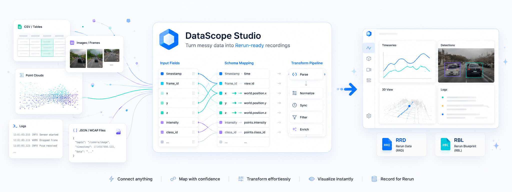

# DataScope Studio

[English](README.md) | [简体中文](README.zh-CN.md)



DataScope Studio 面向机器人与传感器工程师，把本地离线数据快速变成可回放、可检查、
可复用的 [Rerun](https://rerun.io/) 记录。打开数据、自动预览与映射、修正必要问题、
生成可视化并在 Rerun 打开，按需转入项目。
[产品边界与支持矩阵](产品设计.md)是功能承诺的统一依据。

[下载 DataScope Studio](https://github.com/MzKyle/DataScope-Studio/releases) |
[阅读完整文档](docs/README.md)

## 快速上手

1. 从 [GitHub Releases](https://github.com/MzKyle/DataScope-Studio/releases) 下载
   对应平台的安装包。
2. 启动 **DataScope Studio**。安装版会自动启动本地 API、Python runtime 和
   Rerun 集成。
3. 在 **快速查看** 使用 **Quick Inspect**：拖入文件或文件夹，或通过系统选择器
   选择数据源。首次检查不需要先创建项目。
4. DataScope 会检查数据源、推荐可视化模板、生成草稿 Mapping、完成校验，并显示
   **Ready**、**Review** 或 **Blocked** 的 Mapping 就绪状态。
5. Mapping 就绪时点击“生成可视化”。如果需要检查或修复，展开高级 Mapping 编辑器，
   应用修复后重新校验。
6. 点击“在 Rerun 中打开”查看生成的 Recording。
7. 需要持久保存 runs、项目包、批量导入、查询历史、标签和导出时，再创建或打开
   **项目**。

安装包已经包含桌面应用、本地 API、Python runtime、DataScope 包和 Rerun。正常
使用桌面端时，不需要另外安装 Python、Node.js、npm 或 Rerun。

## DataScope 能做什么

- 用统一、可重复的流程检查不同类型的数据。
- 自动识别时间戳、标量、状态、日志、图像、检测结果和点云。
- 不创建正式项目也能快速检查一个本地文件或文件夹。
- 生成可复用的 Rerun `.rrd` Recording 和 `.rbl` Blueprint。
- 在本地管理项目、数据源、Mapping、Recording、任务、标签、参数和查询导出。
- 查询错误日志、低电量、低置信度或无检测结果样本、topic 摘要、Topic 时间范围差异和状态持续时间等常见问题。
- 生成离线机器人诊断报告，并导出 JSON、CSV 或 HTML。
- 导出完整项目包，并在其他机器上重新打开。

## 性能与响应

- 桌面端在 Tauri 环境中优先直接访问本地 FastAPI，只有直接请求失败时才回退到
  Tauri 代理，减少常规 API 调用开销。
- API 启动时异步预热 workspace，健康检查和桌面窗口初始化不会等待完整目录扫描。
- “导入并自动 Mapping”通过单个 import workflow 请求完成添加数据源、inspect、
  模板推荐、草稿 Mapping、预览和校验，减少多次往返带来的等待。
- **Quick Inspect** 在隔离的临时 workspace 内复用同一套导入、Mapping、校验和
  转换流程，因此不会污染正式项目列表。
- 转换任务会限制进度写库频率，避免大文件转换时频繁 SQLite 更新拖慢转换线程。
- 查询系统优先读取转换阶段生成的轻量 query index，并对常见查询模板使用游标式
  读取和结果上限，降低大项目查询时的内存占用。

## 支持的数据

| 数据源 | 示例 | 常用模板 |
| --- | --- | --- |
| 表格 | CSV、JSONL/NDJSON | Sensor Monitor |
| 文本表格与日志 | TSV、TXT、LOG、DAT、LST、LIST，支持逗号、Tab、分号、竖线和空白分隔 | Sensor Monitor |
| 计算机视觉 | 图片文件或图片目录，可配 `annotations.json` 和 `predictions.json` sidecar | CV Detection |
| 点云 | PLY、PCD、NPY、NPZ、XYZ、XYZN、XYZRGB、PTS、ASC 文件或帧目录 | Robotics Debug |
| 机器人 Recording | MCAP 与 ROS2 DB3 bag，包括分片 bag 目录 | Robotics Debug |

DataScope 采用本地优先设计。源数据、Mapping、Recording 和 SQLite 目录默认保留
在本机工作区中，只有主动导出项目包时才会复制数据。

## 快速安装

从 [GitHub Releases](https://github.com/MzKyle/DataScope-Studio/releases) 下载对应安装包：

源码与待发布元数据统一为 `v0.5.0`。下表为本轮候选安装包，完成验收并发布后可下载；
当前已公开版本仍为 [v0.3.1](https://github.com/MzKyle/DataScope-Studio/releases/tag/v0.3.1)。
本轮变更及验收状态见 [v0.5.0 发布说明](docs/releases/v0.5.0.md)。

| 系统 | 安装包 |
| --- | --- |
| Windows 10/11 x64 | `DataScope-Studio-v0.5.0-windows-x86_64-setup.exe` |
| macOS Apple Silicon | `DataScope-Studio-v0.5.0-macos-aarch64.dmg` |
| macOS Intel | `DataScope-Studio-v0.5.0-macos-x86_64.dmg` |
| Debian/Ubuntu x64 | `DataScope-Studio-v0.5.0-linux-amd64.deb` |
| 其他 Linux x64 | `DataScope-Studio-v0.5.0-linux-x86_64.AppImage` |

`v0.5.0` 候选包采用未签名的预发布方式：

- **Windows：** 如果出现 SmartScreen，确认文件来自本仓库后，点击“更多信息”与
  “仍要运行”。
- **macOS：** 将 DataScope Studio 拖入“应用程序”。首次启动时按住 Control
  点击应用并选择“打开”；也可以在“系统设置 > 隐私与安全性”中允许打开。
- **Linux AppImage：** 首次启动前添加执行权限：

```bash
chmod +x DataScope-Studio-v0.5.0-linux-x86_64.AppImage
./DataScope-Studio-v0.5.0-linux-x86_64.AppImage
```

Debian 安装包使用：

```bash
sudo apt install ./DataScope-Studio-v0.5.0-linux-amd64.deb
```

## 桌面端使用流程

- **快速查看：** 无需项目即可选择或拖入数据，查看预览和映射就绪状态，生成 RRD/RBL 并在 Rerun 打开。桌面快速查看不构建查询索引。
- **项目：** 选择/创建项目、导入数据、浏览记录、管理批量任务、打开/导出项目包；高级项目工具提供多记录对比和项目级检查。
- **记录详情：** 概览、检查、筛选默认处理当前记录；自定义查询放在高级筛选面板。
- **设置：** 语言和目录；高级区保留可视化/Mapping 预设、插件与运行配置。
- **转入项目：** 重新导入原数据并保留编辑后的 Mapping；使用新标识重新校验，需在项目内重新生成记录，不迁移临时 RRD/RBL。

规则检查得分仅反映现有规则输出。未发现规则命中不代表全面健康；`time_sync` 比较 Topic 起止范围，不代表逐消息同步验证；检测检查只筛选低置信度或无检测结果样本。API/CLI 的规则 ID 保持兼容。

无表头 CSV 可配置列名；TXT/LOG 等非结构化文本按日志导入。

## 文件与导出

项目默认保存在 `~/.datascope-studio`。未设置自定义产物目录时，Recording 和
Blueprint 会写入项目内的 `recordings/` 与 `blueprints/`。可在“设置”或转换任务
中配置“Rerun 产物目录”；配置后 `.rrd` 与 `.rbl` 会一起保存到指定目录。

使用“导出项目包”可以生成可迁移的 `.datascope.zip`。过去导出的项目包可以通过
仪表盘中的“打开项目包”重新载入。查询和诊断导出默认写入项目的 `exports/`
目录，也可以在导出时指定输出路径。

## CLI 与自动化

桌面端是主要使用入口。如果需要脚本化导入，可以在源码目录或已安装
`datascope-cli` 的环境中运行：

```bash
datascope inspect tests/fixtures/sample_sensor.csv
datascope import tests/fixtures/sample_sensor.csv --project demo --out run_001
datascope import /path/to/run.mcap --project robot_demo --template robotics_debug --out robot_run
datascope recordings --project demo
datascope query --project demo --template low_battery --threshold 0.2
datascope diagnose --project robot_demo --preset strict --format html --out robot_diagnostics.html
datascope project export --project demo --out demo.datascope.zip
```

从源码运行时，先创建开发环境：

```bash
python3 -m venv .venv
. .venv/bin/activate
python -m pip install --upgrade pip
python -m pip install -r requirements-dev.txt
```

然后启动开发版桌面端：

```bash
cd apps/desktop
npm install
npm run tauri:dev
```

## 文档

- [安装与打包](docs/guide/package-install.md)
- [导入与转换流程](docs/workflow/import-convert.md)
- [故障排查](docs/faq/troubleshooting.md)
- [开发环境与启动](docs/guide/run-app.md)
- [架构与 API 文档](docs/architecture/README.md)

## 许可证

DataScope Studio 使用 [Apache License 2.0](LICENSE)。
