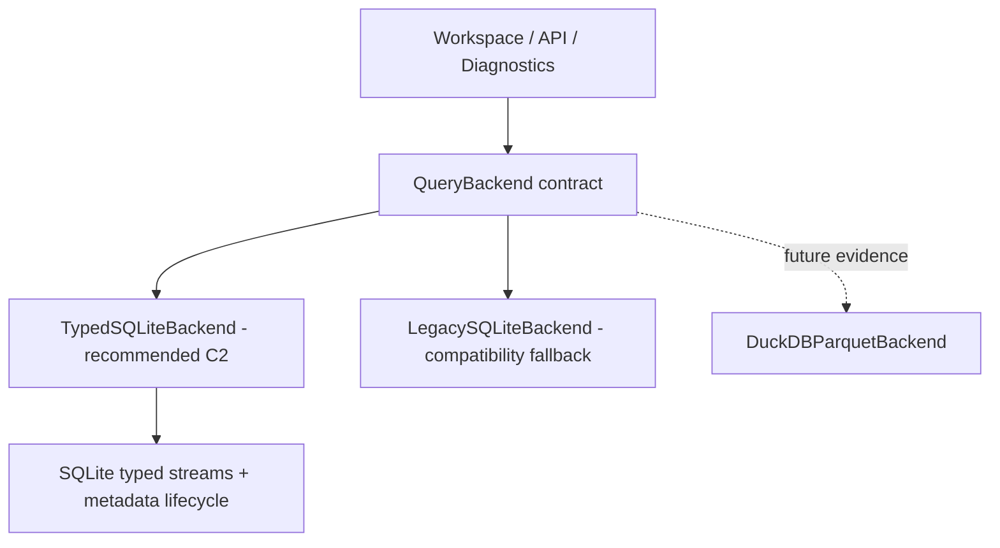

# ADR-001: Keep optimized SQLite for analytical query storage

- Date: 2026-10-17
- Status: Accepted; C2b opt-in implemented, default production switch remains gated
- Decision: **A. Keep optimized SQLite**
- Scope: Phase C Query Storage Architecture Decision Validation
- History: supersedes the 2026-10-06 Phase B recommendation, “C. Plan DuckDB / Parquet migration”. That historical C label differs from Phase C's “C. Evidence still insufficient”.

Implementation follow-up：[Phase C2a](../query-storage-phase-c2a.md)已将 Custom Query 的字段、路径和有限时间筛选接入生产 EAV 路径。
数值/文本比较仍使用原 Python 逻辑。[Phase C2b](../query-storage-phase-c2b.md)已增加显式启用的 CSV typed 存储与兼容读取；
默认仍为 legacy，完整 typed SQL 执行和 Diagnostics 性能门槛仍待后续实施。
[Phase C2c](../query-storage-phase-c2c.md)进一步接入轻量 QueryBackend 和首批 typed 筛选 SQL；聚合与 Diagnostics 仍保持兼容执行。

## Context and evidence

DataScope Studio 是 local-first、离线、build-once/read-many 的机器人数据工具。默认生产路径仍使用 SQLite metadata 和逐字段 JSON `query_rows`；C2b 为新 CSV Recording 提供 opt-in typed 索引。
Phase A/B 的性能问题同时涉及 EAV 布局、类型抹除、排序、候选行传输和 Python filtering/aggregation；当时缺少 Typed SQLite 对照。
因此旧的 production 17,995 ms 与 DuckDB/Parquet 81 ms 不能单独证明必须更换引擎。

Phase C 使用相同 generator、seed、全部 32 个 value fields、七类 Query、输出 limit、完整 compare 聚合与独立 CSV oracle。
Smoke/Small 还逐项对照实际生产 Workspace。Typed SQLite 和两种 DuckDB 路径共享物理字段设计和 SQL compiler。
完整结果、P50/P95、原始样本、SQL/EXPLAIN、输入 SHA256、依赖和恢复 provenance 见
[Phase C 分析](../query-storage-phase-c.md)及[结果归档](../../../benchmarks/results/baselines/2026-10-17-phase-c/README.md)。
[Phase A/B 报告](../query-storage-benchmark.md)保留历史测量与旧决策背景。

Medium 为 3,000,000 primary + 1,000 peer samples，949.980 MB CSV，96,032,000 logical values。
以下均为 sample-only 数据及等价小字典，排除源 CSV、生产 metadata、RRD/RBL；MB 为十进制。
每类 Query 一次 warm-up + 五次正式运行，表中 Query 为 P95 ms。

| Backend | Prepare s | Storage MB / amplification | Workflow peak RSS MB | Errors | Low battery | State | Key | Time range | Threshold | Compare |
| --- | ---: | ---: | ---: | ---: | ---: | ---: | ---: | ---: | ---: | ---: |
| Legacy EAV + SQL pushdown | 660.976 | 23610.020 / 24.853× | 276.804 | 25066.59 | 22300.34 | 36.81 | 21068.45 | 1.40 | 15274.40 | 31818.43 |
| Typed SQLite covering | 43.665 | 1243.353 / 1.309× | 267.919 | 222.11 | 123.55 | 3.92 | 2.45 | 1.12 | 136.65 | 537.74 |
| DuckDB typed table | 4.373 | 234.369 / 0.247× | 704.799 | 8.68 | 3.92 | 7.94 | 7.48 | 10.86 | 3.88 | 19.83 |
| DuckDB querying Parquet | 5.332 | 497.033 / 0.523× | 389.120 | 21.41 | 8.78 | 16.18 | 25.38 | 76.87 | 6.70 | 67.61 |

Medium EAV/typed none/time preparations 来自 10 月 7 日，校验后只读复用；其他 preparation 为 10 月 17 日。
全部最终 Query 在 10 月 17 日测量；修正公共 typed 单分支常量排序后，typed 全部重测，未变化的 EAV 控制保留同日原样本和原 code hash。
Workflow RSS 是实测 build/query 峰值的较大值；不是跨日期同时采集。新建 backend 的 prepare/query 位于同一 worker。
Loader 为 SQLite 单遍 Python CSV/executemany、DuckDB 两遍 native CSV/四线程，不能把整个 build 差距归因于引擎 INSERT。

## Decision

**选择 A. Keep optimized SQLite。下一阶段优先验证 Typed SQLite + SQL pushdown，再决定生产切换。**

优化后的 SQLite 已在本轮 Smoke、Small、Medium 七类 Query 中达到 P95 ≤ 1 秒。
Medium covering layout 的 sample 行从 96,032,000 降为 6,002,000，storage amplification 从 EAV 的 24.853× 降为 1.309×。
完整 prepare 43.665 秒，其中 CSV load 36.623 秒、SQL INSERT 子计时 8.584 秒、四个索引及 ANALYZE 6.955 秒。
无需沿用 EAV 的 32× 行展开，也无需为这组预算增加新的生产查询引擎依赖。

DuckDB 的批量分析、压缩和 native load 明显更优，尤其 compare 和扫描查询；本次没有否认这一收益。
但 SQLite 已满足选定交互预算，RSS 更低，并可利用现有 SQLite 事务与打包基础。
目前额外速度和磁盘节省尚不足以优先承担另一套 native dependency、跨平台 wheel、engine resource management 与多文件 dataset lifecycle 的实现成本。
这是一项有明确适用范围的工程取舍，不是通用 SQLite 容量上限或所有机器人 semantic 的性能保证。

四种 SQLite variant 的取舍也影响结论：无索引的 Medium time range 达 17.630 秒；仅 time indexes 的 compare 为 1.563 秒；
minimal 四索引 compare 仍为 1.197 秒。Covering 与 minimal 同为四索引，多约 54.682 MB / 0.595 秒 index cost，compare 降至 0.538 秒。
优先使用这组有测量支持的索引形态，避免给所有字段建立索引。固定 CSV wide table 仅是对照实现，生产需按 stream/schema 设计。

## Alternatives

| Option | Assessment |
| --- | --- |
| A. Keep optimized SQLite | 本轮选择；typed layout/SQL pushdown 已满足测量范围内的交互预算，依赖和事务整合成本较低 |
| B. SQLite metadata + DuckDB querying Parquet | 保留为扩展选项；更快、更小，但需 dataset registry、发布/删除/恢复协议及 native packaging 验证 |
| C. Evidence still insufficient | 全面生产切换证据仍不齐；但当前 workload 的下一实现方向已有充分对照，不必因未验证语义而放弃本轮明确选择 |
| Durable DuckDB table | 本次最快、最小；不支持仅为已在预算内的几十毫秒差异再同时保存 DuckDB DB 和 Parquet |
| Continue legacy EAV unchanged | 保留兼容 fallback，不能作为解决已观察到的空间/扫描成本的最终方向 |

DuckDB native table 与 Parquet 的速度差异可由存储编码、row-group、文件/metadata 访问与 reader 路径解释为候选原因，属于推断，未做因果 profiling。
官方 [file formats guide](https://duckdb.org/docs/current/guides/performance/file_formats)讨论格式选择的性能影响。
如果后续重新选择 B，优先 Parquet 为 durable analytics storage、DuckDB 为 execution engine、SQLite 为 transactional metadata/registry；RRD/RBL 维持现有职责。
未来只有新测量证明 native DB 的必要性，才增加该持久状态。

## Decision gates before a production switch

| Gate | Phase C result / required action |
| --- | --- |
| 普通分析 Query P95 ≤ 1000 ms | 本轮 covering variant 在三档、七类 Query 通过；新目标机器、semantic 和更大规模重新测量 |
| Diagnostics P95 ≤ 5000 ms | C3 完整 32 字段 typed Smoke / Small 最终复验分别为 **154 / 4182 ms**，精确报告与冻结对照 / 分组 oracle 一致；Medium、异常组和新目标机器仍需单独验收，见 [C3 归档](../../../benchmarks/results/baselines/2026-10-18-phase-c3/README.md) |
| Correctness and public contracts | 本轮 CSV 七类 parity 通过；继续验证 API/CLI/Desktop、稳定排序/limit、完整聚合、null/mixed、异步 stream、text/CV/ROS 与 schema evolution |
| Build and memory | 记录 source scope、INSERT/load/index、峰值 RSS 和 transient disk；在目标低内存机器与真实 Recording 重测，不只看 warm query |
| Storage | 本轮 covering 为 1.309× CSV；按真实编码和缺失率重新测量，验证删除、空间回收和 compaction |
| Lifecycle / recovery | 构建失败、取消、重试、checksum/version、旧 Recording fallback、事务一致性、删除、崩溃恢复和 Windows reader 生命周期需验证 |
| Packaging / cross-platform | Linux/macOS/Windows 与目标架构安装/启动/查询回归；本轮 Windows 测量不能代替交付验证 |
| Concurrency / implementation cost | 单 writer/多 reader 边界、连接关闭、schema grouping 与 migration strategy 需设计并测试 |

若真实目标 workload 在合理索引下仍超过 1 秒、低内存/磁盘预算无法满足，或完整 scan/aggregate 成为主流，应以同语义、同输入的 SQLite/Parquet 对照重新评估 B。
本轮固定 warm cache、单机、一次 prepare、五个 Query 样本；P95 是五次最大值，不能解释成稳定生产 tail SLO。
Peer 只有 1000 samples；两条同规模 Recording、cold cache、并发与 Large 尚未覆盖。

## Next-stage design only

推荐接口：`query()`、`query_template()`、`compare()`、`aggregate()`、`build_index()`、`delete_recording()`。
Contract 保持现有输出列、类型、排序、时间边界、路径前缀、阈值和输出 limit；aggregate 不截断输入。
`build_index()` 接收 typed stream/schema/checksum，在失败/取消时不发布部分索引；`delete_recording()` 维护 registry 与 samples 一致性。
Typed SQLite 优先以同一个 SQLite transaction 管理 metadata 与样本生命周期；若分库则必须明确新的提交/恢复协议。
按 Recording/stream/schema 组织样本，保留不同时间轴和缺失语义，避免把本次固定 wide CSV schema 直接当成全局模型。

**Phase C2 推荐 QueryBackend contract + TypedSQLiteBackend + Legacy fallback/parity；不建议自动进入 DuckDBParquetBackend 生产迁移。**
C2a/C2b 后续实施已获得授权：C2b 将 metadata.sqlite 升至 v4，增加私有 typed writer/reader 和 legacy 路由，未引入完整 QueryBackend 框架或变更默认 backend，旧 query_rows 数据保留。
C2c 的[生产实现](../query-storage-phase-c2c.md)引入只含计划与有序读取的轻量 QueryBackend，
先支持 Custom Query 数值筛选、low_battery 和 find_errors；不采用上述候选接口中的通用 aggregate、build_index 或 delete_recording 抽象。
旧 EAV 与暂不支持的 typed 条件保留兼容执行，compare、state_duration、Diagnostics 的完整算法与默认 legacy 构建不变。
Time_sync 的已知 20 ms offset 检测缺口仍未修复，不能用其速度宣称业务正确。

Phase D 单独测量 Rerun Build Optimization：historical Smoke build 222.680 秒，Rerun 占 84.2%。
already-sorted fast path、external sort removal、batch/columnar ingestion 和 Python/SDK call overhead 留给该阶段。
