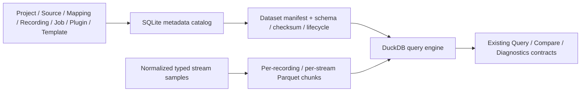

# Query Storage Benchmark：Phase A / Phase B

历史测量日期：2026-10-06。Phase A/B 当时的决策为 **C. Plan DuckDB / Parquet migration**。
2026-10-17 的 [Phase C 对照](query-storage-phase-c.md)补齐 Typed SQLite 后，已由 [ADR-001](adr/ADR-001-query-storage.md)修订为 **A. Keep optimized SQLite**。
以下保留 Phase A/B 的数据、局限和历史规划；生产 Query、Diagnostics、API、CLI、Desktop 继续使用现有 SQLite 路径。

证据入口：[基线及命令](../../benchmarks/results/baselines/2026-10-06/README.md)、
[Benchmark 使用说明](../../benchmarks/README.md)、[ADR-001](adr/ADR-001-query-storage.md)。

## Context

问题是当前 `query_rows` 数据模型能否支持高频、多字段、长时间机器人 Recording。
本次使用具有规律的合成机器人 CSV，通过真实 Workspace 导入、inspect、Mapping、Rerun 和 Query Index 路径测量。
没有真实设备采集日志；结果代表这里声明的 scalar/state 工作负载，不代表所有机器人数据或所有 Adapter。

已完成的完整 Recording 最大为 30,000 samples / 960,000 query rows。
更大数据使用独立 index-only 模式，不能据此宣称 Rerun 完整构建成功。
Medium（约 1 GB CSV）和 Large（约 3–5 GB CSV）预设可运行，Phase A/B 当轮没有执行这两档；Phase C 已完成 sample-only Medium，未执行 Large 或 Medium 完整 Rerun build。
本报告给出观测到的可用性边界，不声称找到了 SQLite 的硬容量上限。

## Current Architecture

关键实现：[workspace_query.py](../../packages/core/src/datascope_core/workspace_query.py)、
[query.py](../../packages/core/src/datascope_core/query.py)、
[workspace_database.py](../../packages/core/src/datascope_core/workspace_database.py)。

`query_rows` 没有独立主键，字段为 `recording_id, source_id, time, entity_path, semantic_type, key, value_json`。
多个字段重复存储 Recording、Source、路径、时间和语义字符串；数值以 JSON 文本存储。
当前索引为：

| Index | Columns |
| --- | --- |
| `idx_query_rows_recording` | `recording_id` |
| `idx_query_rows_key` | `key` |
| `idx_query_rows_recording_semantic_key` | `recording_id, semantic_type, key, entity_path, time` |

`QUERY_INDEX_BATCH_SIZE = 10_000` 限制写入批次，CSV chunk 为 50,000 samples；它们没有限制总行数。
本次 CSV 的每个启用 scalar/state 字段生成一行。`error_code` 是额外的 numeric scalar，timestamp 作为时间列。
因此 `query_rows = samples × (scalar_fields + state_fields + 1)`；默认 1 个 state 时为 12×、32×、102×。
该公式针对这里验证的 Mapping；MCAP topic summary、text log 等其他语义有不同的展开规则。

`run_query()` 部分模板使用 iterator，state duration 使用候选行列表。
`custom_query()` 的 key/time/numeric 筛选发生在 Python 中，SQLite 只预先限制 Recording/semantic type。
`compare()` 可把 metric token 下推为 SQL LIKE，但仍在 Python 汇总候选行；未指定 metrics 时读取所有相关字段。
Diagnostics 依赖 Query Index，会物化全部通用候选行再运行规则。
SQL 的时间排序与复合索引列顺序不同，实测计划包含 `USE TEMP B-TREE FOR RIGHT PART OF ORDER BY`。
`limit=1000` 限制输出，不限制排序、晚时间窗口扫描或完整聚合的工作量。

## Benchmark Methodology

- 平台为 Windows 10 build 26300，Intel Core i9-13900HX，32 logical CPUs，16.907 GB RAM；Python 3.11.5。
  SQLite 3.42.0，DataScope 0.4.0，Rerun SDK 0.33.1，pandas 2.3.3，psutil 7.2.2；PoC DuckDB 1.5.6。
  生产源码基于 commit `3b3840bd3e7dd66c90bcfdadfb8704158a2fdfac`，依赖版本未改写到生产配置。
- 流式生成 monotonic timestamp、平滑位置/速度、电池下降、temperature 小噪声、状态和稀少错误码。
  seed 为 20261006。电池在每个 Recording 的声明时长内从 0.95 降到 0.05，以覆盖阈值查询；这不是设备电池寿命模型。
- 每个矩阵用例在独立进程中顺序运行。一次 warm-up + 五次正式查询；较大 index-only 测试为一次 warm-up + 三次。
  JSON 保存所有 samples 和 min/mean/median/nearest-rank P95/max。五次或三次的 P95 都等于最大值，不能当作稳定生产尾延迟估计。
- benchmark-only subclass/proxy/局部 patch 计时，没有修改生产实现。
  `inspect_ms` 扣除嵌套 profile，`inspect_total_ms` 包含 profile；build 分为 Rerun、Query Index、其他阶段。
  `query_insert_ms` 只计 executemany，事务提交、解析、展开、JSON 等计入总 `query_index_ms`。
- SQLite 大小在显式 WAL checkpoint 后、添加 peer 前测量，包含 Catalog metadata 和三个索引。
  MB/GB 为十进制。实际后续连接 `synchronous=2`，不能把初始化连接的 NORMAL 设置当成所有连接的设置。
  当前 SQLite 不提供 `dbstat`，JSON 对象级大小为 null；不能用猜测补齐各索引页数。
- 使用 psutil 每 10 ms 采样真实进程 RSS，包含本进程 native allocation，并记录每阶段 before/after/peak。
  Windows OS working-set peak 另列。短时尖峰可能漏采；子进程和系统文件缓存不计入 RSS。
- 默认查询输出上限 1000，compare peer 为真实第二条 Recording，最多 1000 samples；并非两条等规模大 Recording。
  Smoke 额外执行全字段 compare 和现有 Diagnostics。
- 每次验证构建状态、RRD/RBL 非空、精确 Query Index 行数、结果 shape/count/value、相邻 state duration、阈值、时间窗口、compare aggregate。
  Diagnostics 检查完整通用行覆盖；重复输出校验发生在计时外。失败结果不作为决策证据。
- 采用 warm filesystem cache、固定测试顺序，没有冷缓存或并发用户测量。最终基线与验证测试顺序独立执行。
  硬件后台负载、profile 启动成本和 Rerun 波动不能归因于 SQLite。

早期计时用 `Mock(side_effect=...)`，它保留每个 INSERT batch 的参数，导致构建 RSS 随总行数虚增。
计时钩子已改为直接替换 callable，新增 weak-reference 回归验证 batch 可在下个 batch 前释放。
受影响的完整 pipeline/RSS 基线重新测量，较大未完成试跑被标为 failed，不进入最终基线。
早期独立索引实验使用普通 Workspace + 直接 SQL，发生在 batch hooks 释放且 GC 之后，未受该问题影响；它单独归档并排除原 pipeline/RSS。

## Dataset Matrix / Row Amplification / Storage Amplification

| Case | Mode | Hz | Scalars + states | Duration s | Source rows | Query rows | Row amp | CSV MB | SQLite MB | Storage amp |
| --- | --- | --- | --- | --- | --- | --- | --- | --- | --- | --- |
| A | full | 50 | 10 + 1 | 10 | 500 | 6,000 | 12× | 0.058 | 1.757 | 30.45× |
| B | full | 200 | 30 + 1 | 10 | 2,000 | 64,000 | 32× | 0.627 | 16.593 | 26.48× |
| C | full | 1000 | 30 + 1 | 10 | 10,000 | 320,000 | 32× | 3.132 | 82.305 | 26.28× |
| D | full | 200 | 100 + 1 | 10 | 2,000 | 204,000 | 102× | 2.027 | 52.003 | 25.65× |
| Smoke | full | 200 | 30 + 1 | 150 | 30,000 | 960,000 | 32× | 9.446 | 246.792 | 26.13× |
| Small index | index-only | 200 | 30 + 1 | 1500 | 300,000 | 9,600,000 | 32× | 94.673 | 2470.486 | 26.10× |

所有列数之外还有 numeric `error_code` 和 timestamp，避免把 30 telemetry scalars 误称为总共 30 列。
A 的 30.45× 包含小数据 Catalog 固定开销；B/C/Smoke 的放大约 26×，并不是固定开销单独造成。
B→C 在固定 10 秒内增加频率，行数和存储约增加五倍；B→D 保持频率和时长，字段数推动放大从 32× 增至 102×。
B→Smoke 延长时长到 150 秒，放大倍数仍约 26×，绝对空间和晚窗口扫描成本继续增加。
Small 将时长再延长十倍，SQLite 达 2.470 GB，依然约 26×；另记录 4.850 MB checkpoint 后 sidecar 空间。

## Pipeline Results

| Case | Generation s | Import s | Inspect excluding profile s | Profile s | Mapping suggest + validate s | Build s | Rerun artifacts s | Query Index s | Index / build |
| --- | --- | --- | --- | --- | --- | --- | --- | --- | --- |
| A | 0.003 | 0.007 | 0.024 | 0.486 | 0.006 | 0.935 | 0.821 | 0.056 | 6.0% |
| B | 0.025 | 0.008 | 0.036 | 2.150 | 0.024 | 13.454 | 11.372 | 1.912 | 14.2% |
| C | 0.126 | 0.011 | 0.064 | 2.355 | 0.034 | 61.391 | 52.381 | 8.774 | 14.3% |
| D | 0.077 | 0.009 | 0.082 | 20.625 | 0.024 | 31.464 | 24.961 | 5.989 | 19.0% |
| Smoke | 0.387 | 0.017 | 0.097 | 3.440 | 0.027 | 222.680 | 187.516 | 35.006 | 15.7% |
| Small index | 6.522 | 0.239 | 1.408 | 8.679 | 0.015 | not measured | not measured | 281.446 | not measured |

Smoke 的 executemany 累计 15.531 秒，剩余 19.474 秒包含 source 解析/逐字段展开/JSON/事务等，不能全部称为索引维护。
RRD 为 84.227 MB，RBL 为 0.033700 MB；其他 build 时间为 0.158 秒。
完整构建的主要阶段是 **Rerun artifact**（Smoke 84.2%），Query Index 不是当前完整 build 的第一瓶颈。
本轮不修改 Rerun 写入方式。高字段 D 的 profile 也明显耗时；一次 cold run 无法给出它的稳定吞吐率。
Small index-only 的 executemany 为 129.297 秒，总 Query Index 281.446 秒；没有 RRD/RBL 或完整 Build 占比。

## Query Latency

以下单位均为 ms，数值为 P50 / P95。每个查询独立 warm-up 和重复。

| Query | A | B | C | D | Smoke | Small index |
| --- | --- | --- | --- | --- | --- | --- |
| find_errors | 14 / 32 | 39 / 86 | 213 / 298 | 28 / 55 | 487 / 655 | 5,252 / 5,512 |
| low_battery | 33 / 37 | 74 / 98 | 410 / 487 | 162 / 189 | 1,673 / 1,760 | 18,465 / 19,173 |
| state_duration | 13 / 16 | 29 / 55 | 187 / 236 | 27 / 40 | 580 / 719 | 7,300 / 7,710 |
| custom scalar key | 64 / 131 | 707 / 766 | 2,784 / 3,062 | 2,221 / 2,285 | 6,912 / 7,012 | 62,037 / 75,503 |
| custom late time range | 57 / 134 | 1,018 / 1,124 | 6,442 / 6,541 | 2,726 / 3,131 | 17,397 / 17,995 | 54,039 / 59,982 |
| custom numeric threshold | 55 / 85 | 1,058 / 1,229 | 6,684 / 7,557 | 2,882 / 2,938 | 17,106 / 18,609 | 191,358 / 200,115 |
| compare: two metrics | 55 / 60 | 198 / 307 | 1,664 / 1,777 | 405 / 429 | 3,019 / 3,420 | 26,701 / 27,399 |
| diagnostics | 106 / 212 | 1,305 / 1,339 | 7,530 / 10,779 | 3,003 / 3,300 | 23,033 / 23,668 | not measured |

Smoke 全字段 compare P50/P95 为 **24,461 / 31,640 ms**，返回 64 行 aggregate，仍需读取两条 Recording 的所有 scalar/state 候选行。
Smoke 晚窗口只返回 11 个 samples × 32 字段 = 352 行；它的约 18 秒不是输出数据量造成。
D 的窗口超过 limit，返回 1000 行；其 P95 为 3.131 秒。

`time_sync` 在 CSV 中没有 topic summary，Smoke 的 293 / 359 ms 为 **空结果路径**，不能称为传感器同步性能。
正式基线另外生成 MCAP：两个实际 inspect topic、四条消息、四行 metadata Query Index，一条模板输出。
Smoke 的 MCAP metadata 路径 P50/P95 为 10.52/12.12 ms；Small index 为 12.10/12.48 ms。
MCAP 消息包含 20 ms topic offset，但当前 inspect 给每个 topic 相同的 file-wide 时间范围，模板返回零 delta。
这里验证并记录现有行为，**没有验证正确识别传感器 offset**；per-topic 时间范围需要后续任务。

Small index 验证了 9.6m 行可构建并完成这组 Query，不能据此宣称 SQLite 已达到硬容量上限。
其 numeric threshold 三次正式耗时为 53.296 / 191.358 / 200.115 秒，波动明显；warm-up 与三次运行不足以给出稳定尾延迟或唯一原因。
已测 A 的 6k 行中上述所有 Query 均低于 212 ms P95；B 的 64k 行中部分 custom 已超过选定的 1 秒预算。
这仅描述这些工作负载的交互可用性，不能推广为所有字段/模板共享的行数阈值。

## Memory

| Case | Process before MB | Process after MB | Sampled peak MB |
| --- | --- | --- | --- |
| A | 97.456 | 147.317 | 158.630 |
| B | 97.407 | 188.420 | 220.471 |
| C | 97.362 | 177.066 | 436.031 |
| D | 97.886 | 186.278 | 325.296 |
| Smoke | 97.624 | 207.155 | 934.932 |
| Small index | 98.132 | 140.009 | 603.906 |

Smoke recording build 阶段峰值为 187.757 MB；custom time range 为 167.576 MB。
全字段 compare 达到 924.598 MB，diagnostics 达到 934.932 MB，说明 iterator 不能保证所有 analytical consumers 的内存有界。
Small index 构建阶段为 158.724 MB，但 state duration 达 485.655 MB、两指标 compare 达 603.906 MB。
因此当前索引写入可以保持有限批次内存，候选行物化的 Query consumers 仍随选中数据规模增长。
不能由 smoke 外推 1 GB/5 GB CSV 的 RSS；较大 index-only 测量跳过 diagnostics 和全字段 compare，因此其峰值覆盖更窄的 workload。

## Index Maintenance versus Query Benefit

从 Smoke 取前 5,000 和后 5,000 个完整 samples，共 320,000 query rows。
每个 variant 创建全新 scratch Catalog，使用相同 `INSERT SELECT`，不改生产索引。
插入计时包含事务提交，排除 Python/CSV/JSON 开销；query 输出与全索引 variant 一致。

| Variant | INSERT s | SQLite MB before deferred build | find_errors P95 ms | key P95 ms | late range P95 ms |
| --- | ---: | ---: | ---: | ---: | ---: |
| all three | 3.690 | 82.391 | 162 | 2641 | 5898 |
| none | 0.943 | 35.647 | 261 | 1070 | 4376 |
| without recording | 2.906 | 71.016 | 203 | 2893 | 6445 |
| without key | 3.213 | 75.698 | 130 | 2849 | 6606 |
| without composite | 2.395 | 53.715 | 267 | 846 | 4915 |

无索引插入后，独立创建 recording/key/composite 分别为 454 / 247 / 1290 ms；总插入 + deferred build 为 2.934 秒。
全索引插入较无索引约 3.9×，存储约 2.3×；复合索引改善部分 state/error 查询，但并未改善所有 Python 后过滤查询。
记录计划显示复合索引需要额外时间排序；省略它时改用 Recording index。
固定顺序、单次 INSERT、小于主数据的样本、热缓存和不同聚簇都影响结果。
这是进一步研究 SQL pushdown、排序索引和 deferred indexing 的证据，**不足以直接删掉生产索引**。

## Independent DuckDB / Parquet PoC

Phase A 完成后才运行 [duckdb_poc.py](../../benchmarks/duckdb_poc.py)。
它校验同一份 Smoke source 的 SHA256，并将原始生产 SQLite 输出作为七类查询的独立 golden reference。
SQLite 原始 Catalog 只读，typed DuckDB table 和 Parquet 都位于独立临时目录；生产没有 DuckDB dependency 或 routing。
默认四线程、1 GB engine memory limit。所有 telemetry/state/error_code 列保留，字段展开发生在查询时。

比较三条实验路径：原 SQLite EAV 上 SQL pushdown、DuckDB typed wide samples、DuckDB 查询 ZSTD Parquet。
结果 count/order/type/value/state duration/两个 Recording 的 aggregates 均校验；浮点 absolute tolerance 1e-8、relative tolerance 1e-10。
并行 AVG 的最后浮点位可变化，每次都对 golden 校验；JSON 记录不同 raw hash 数，而不把这个差异伪装成稳定字节输出。

| Metric | Smoke PoC result |
| --- | ---: |
| Primary + peer source sample rows | 30,000 + 1,000 |
| Logical query-time expanded rows | 992,000 |
| Existing SQLite primary Query Index build | 35,006 ms |
| DuckDB typed CSV ingest + checkpoint, primary + peer | 437 ms |
| Parquet export, primary + peer | 113 ms |
| DuckDB query views + checkpoint | 186 ms |
| SQLite primary + peer live Catalog, including small topic fixture | 255.119 MB |
| DuckDB samples + views, primary + peer | 3.420 MB |
| Parquet sample data, primary + peer | 5.529 MB |

| Query P50 / P95 ms | Production SQLite | SQLite SQL pushdown | DuckDB table | DuckDB Parquet |
| --- | ---: | ---: | ---: | ---: |
| find_errors | 487 / 655 | 168 / 188 | 13 / 16 | 56 / 60 |
| low_battery | 1673 / 1760 | 757 / 854 | 15 / 19 | 65 / 85 |
| scalar key | 6912 / 7012 | 600 / 617 | 15 / 17 | 66 / 113 |
| late time range | 17397 / 17995 | 245 / 335 | 15 / 19 | 72 / 81 |
| numeric threshold | 17106 / 18609 | 553 / 614 | 15 / 18 | 58 / 59 |
| state_duration | 580 / 719 | 245 / 276 | 39 / 50 | 69 / 80 |
| compare | 3019 / 3420 | 608 / 615 | 34 / 36 | 82 / 109 |

PoC sampled process peak 为 180.699 MB；CSV ingest 阶段 180.699 MB，DuckDB table compare 阶段 171.307 MB，Parquet compare 177.373 MB。
这些是同一进程按固定顺序执行的绝对 RSS，包含 retained correctness reference 和前序 allocator，不能当作各引擎独立 fresh-process 峰值。
也不能拿 PoC 的峰值和包含 diagnostics 的 Smoke 934.932 MB 直接比较。

SQL pushdown 把现有 SQLite 晚窗口从 17.995 秒降低至 335 ms，表明大量当前延迟来自 Query 执行方式，而非 SQLite 引擎本身。
Parquet 在此 workload 下进一步降到 81 ms；sample data 文件比 255.119 MB live Catalog 小约 46×。
这不是同物理模型的 engine 对决：typed column layout、压缩、运行时字段展开和 SQL pushdown 一起改变。
SQLite 包含 Metadata 和 indexes，DuckDB/Parquet 只含 sample data 和少量 view，大小范围也不同。
合成时间序列比较平滑、state 重复率高，压缩比不代表真实设备噪声或所有 semantic 的压缩比；更不能当作整个 Workspace 的缩小倍数。
CSV ingest 与 SQLite reparsing/expansion/JSON insertion 阶段不同；PoC 不构建 RRD/RBL。
生产延迟引用 earlier baseline，后台负载可能不同；仍需要目标机器上重复完整对照。

实现复杂度明显高于加一个 SQL filter：本 PoC 只覆盖确定性非 null CSV scalar/state。
未覆盖 diagnostics parity、time_sync、CV/ROS、混合/缺失值、schema evolution、删除和并发写入。
未来生产设计必须处理不同 stream 时间轴和不同 schema，不能把这个固定宽表直接替换整个 `query_rows`。
DuckDB 的 CSV/Parquet 能力参考官方 [CSV documentation](https://duckdb.org/docs/current/data/csv/overview)
与 [Parquet documentation](https://duckdb.org/docs/current/data/parquet/overview)。

## Observed Bottlenecks

1. **完整 Recording 构建：Rerun artifact conversion。** Smoke 187.516/222.680 秒；本轮没有证据称 Query Index 是第一构建瓶颈。
2. **分析查询：字段展开、SQL 排序、Python 后过滤与物化。** Smoke 晚窗口/threshold 约 18 秒，全字段 compare/diagnostics P95 约 32/24 秒；Small index custom P95 达 60–200 秒。
   只有 352 行窗口输出，仍扫描大量候选；SQL pushdown 对照证实可以消除相当部分成本。
3. **持久化模型：32×/102× 行展开及约 26× CSV 存储放大。** 三个索引继续增加写入和空间，去掉索引也保留 EAV 重复数据。
4. **内存：全量 analytical consumers。** Compare/diagnostics 在不到一百万 Query Rows 时已接近 1 GB 进程 RSS。

## Alternatives

| Choice | Benefit | Limitation / evidence |
| --- | --- | --- |
| A. Keep SQLite | 无新增运行时，SQL pushdown 可明显改善延迟 | 仍保留字段展开与 storage amplification；当前 64k 行部分 custom P95 已超过 1 秒 |
| B. Keep SQLite + QueryStore | 可隔离未来 backend 和 Diagnostics 依赖 | 接口本身不解决已有存储/扫描问题；需设计 stream 语义和 parity，不能用抽象代替测量 |
| SQLite typed normalized samples（未测） | 也可避免持久化逐字段展开，保留现有引擎 | 本轮没有这个物理布局的性能/空间证据；正式选择 backend 前应作为对照，不能据 EAV 结果断言 SQLite 引擎必然不适用 |
| DuckDB typed tables | PoC 很快，少量文件，便于本地 SQL | 仍需要 catalog 生命周期、并发边界、schema 演进和迁移设计 |
| C. Plan DuckDB + Parquet | 保留 SQLite metadata，用压缩 typed samples 支持分析；PoC 显示空间和查询收益 | 多文件生命周期、写入发布、删除、schema/stream compatibility 更复杂，本轮仅计划和 PoC |

## Historical Phase B Decision / Consequences

**Phase B 当时选择 C. Plan DuckDB / Parquet migration。** 此方向已由 Phase C 的 Typed SQLite 对照和当前 ADR 修订；以下为保留的历史规划。
生产路径本轮继续 SQLite，不实施 QueryStore，不删除索引，也不把 PoC 接入 API/CLI/Desktop。
短期 SQLite SQL pushdown 是合理备选或过渡工作；这个实验表明它能改善延迟，但无法解决每 sample 多行重复存储。

未来设计方向：

保留原始 Source 和 RRD/RBL 生命周期；未来 sample dataset 应先写临时文件，成功后发布 manifest，再由 metadata 引用。
不同 semantic stream 保留自己的时间轴、类型和缺失值语义，适配层维护现有 `QUERY_COLUMNS` 和查询顺序。
这些是设计约束，没有在本轮生产实现中加入。

## Future Trigger Conditions / Acceptance Gates

以下是**重新评估或启动迁移的条件**，不是 SQLite 硬上限；均附测量或预算依据：

| Condition | Basis / action |
| --- | --- |
| 常用 Query P95 > 1000 ms | 选择 1 秒为 interactive query 验收预算；B 的时间窗口 1124 ms / numeric 1229 ms 已触发。64k 是该 workload 的观测点，不是通用 sample 阈值 |
| Diagnostics P95 > 5000 ms | 选择 5 秒为单 Recording 手动诊断预算；C 的 320k 行达 10779 ms，Smoke 达 23668 ms |
| 单 Recording ≥ 960k Query Rows 或 Catalog ≥ 246 MB | 已测完整 Smoke 工作负载，custom 7–20 秒、全量分析约 1 GB RSS；新增目标规模至少重复这组测试 |
| Row amp ≥ 32× 且 Storage amp ≥ 20× | 20× 是规划磁盘预算警戒值，当前 30-field baseline 已测 32× / 26×，应比较 normalized sample layout；并非数据必然无法写入 |
| Query Index 占完整 Build ≥ 25% | 25% 为后续优化优先级预算；当前 full 最大约 19.0%，尚未触发。仅此占比不能否定查询/空间的迁移证据 |
| 数据规模超出本次覆盖，或引入多 writer / 新 semantic | 必须重新测量；不允许以 Medium/Large 配置存在来宣称其已通过 |

正式迁移前必须通过七类 Query plus diagnostics/time_sync 的输出 parity、API/CLI/Desktop 回归、stream deletion、失败恢复、并发边界、schema evolution/null/mixed type。
应执行完整 Small Rerun build，以及 Medium/Large 的分阶段存储/Query 测试；compare 使用两条同规模 Recording，记录 cold/warm cache 和更充分 tail samples。
应加入 normalized SQLite 对照，以区分布局收益与引擎收益，并记录线程配置、导入和磁盘范围。
若 SQL pushdown + 改进 SQLite 布局在目标约束下达到同等空间/延迟收益，可在新的 ADR 中重新选择 A/B；本次证据不锁死最终 backend。

## Validation / Remaining Limits

普通 pytest 不收集 Benchmark，psutil/DuckDB 不进入 production requirements。
现有 Python tests 211 passed / 5 skipped，前端 14 files / 69 tests passed，frontend build 和 release sanity check passed。
首轮 Python 全量出现两条 MCAP/ROS2 CLI 测试失败，随后 targeted、clean baseline 和当前工作树全量通过，未修改生产源码或这些测试。
Tauri Rust check 尝试执行但环境没有 `cargo`，因此没有声称 Tauri build 验证成功。
opt-in Benchmark 测试结果记录于基线索引；它们使用极小真实数据，并验证失败清理、独立 keep flags 和 PoC 原 Catalog 只读。

默认清理唯一工作目录；只有显式 keep flags 才保留对应大文件，强制终止不保证 finally 清理。
Git 仅保存 curated JSON/Markdown，没有提交 CSV/SQLite/RRD/RBL/DuckDB/Parquet。
