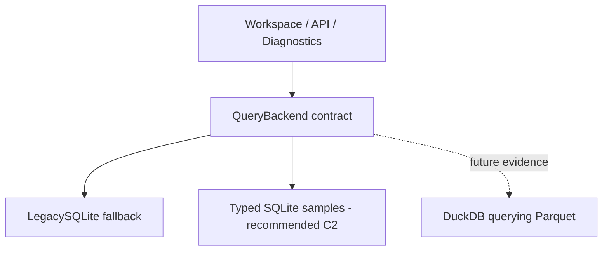

# Query Storage Phase C：Architecture Decision Validation

本报告使用 Typed / Normalized SQLite 对照验证 Phase B 的迁移规划。
2026-10-17 的决策为 **A. Keep optimized SQLite**：下一阶段优先 Typed SQLite + SQL pushdown，生产切换仍须通过 diagnostics 和完整语义验收。
历史证据保留在 [Phase A/B 报告](query-storage-benchmark.md)；当前决策以 [ADR-001](adr/ADR-001-query-storage.md) 为准。

## Scope and audit

Phase C 只修改 Benchmark、架构文档和 TESTING.md。没有生产 QueryBackend、metadata.sqlite migration、API/Desktop 变化或 Rerun 优化。
复用现有 DatasetConfig、generator、latency_stats、measure_query、MemorySampler、query_calls 和结果校验。
seed 固定为 20261006；timestamp 单调，position/velocity 平滑，temperature 带小噪声，battery 覆盖阈值，state 含稀少错误和 warning。
本次仍是合成非 null scalar/state CSV，不代表全部机器人 semantic。

Phase B 有两个公平性限制：SQLite SQL 下推对照仍使用 EAV/JSON，而 DuckDB 使用 wide samples；多个引擎的 RSS 在一个进程中记录。
其 DuckDB 路径也在查询时生成 JSON 并在 Python 解码。Phase C 保留旧结果，采用新结果目录和新代码 hash，测量以下七组配置：

| Backend / variant | Samples | Dictionary | Secondary sample indexes |
| --- | --- | --- | --- |
| Legacy SQLite EAV + SQL pushdown | 逐字段 query_rows/value_json | 同样的 recording/field/state metadata | 现有三个索引，载入后建立 |
| Typed SQLite none | numeric wide row + state-code row | recording/field/state | 无 |
| Typed SQLite time | 同上 | 同上 | numeric/state 各一个 recording/time 索引 |
| Typed SQLite minimal | 同上 | 同上 | 前两个，加 battery/value/time 和 robot_state/value/time，共四个 |
| Typed SQLite covering | 同上 | 同上 | 同为四个，numeric time index 附带 battery/temperature，覆盖本次 compare |
| DuckDB typed table | 与 Typed SQLite 相同 | 相同 | 无 sample indexes |
| DuckDB + Parquet | 与 Typed SQLite 相同 | 同等 dictionary manifest | 无；查询 Parquet |

三种 typed 路径保存相同的 numeric columns、INTEGER error_code、dictionary-encoded state 和 timestamps。
它们不是只存两项被查询的 metric；32 个 value fields 全部保留。
每 sample 的物理样本行从 EAV 的 32 行变为两行，其中 numeric 一行持有 31 个 typed 数值，state 一行持有状态 code。
小型字典行另计，logical value count 在所有 backend 中仍相同。
这是针对已对齐 CSV samples 的 normalized 控制，不是要求未来所有异步 sensor stream 共用一张固定宽表。

## Query and correctness contract

七类查询与 Phase B 相同：find_errors、low_battery、state_duration、scalar key、late time range、numeric threshold、battery/temperature compare。
默认 limit 为 1000；late window 覆盖 11 samples，默认 32 fields 时返回 352 行。
Compare 聚合两个 Recording 的每个 sample，不以 limit 截断聚合输入；peer 的真实规模写入报告，默认最多 1000 samples。

Typed SQLite 与 DuckDB 共用 SQL compiler。Key/semantic/path 元数据解析为列投影；SQL 仍包含对应条件。
Recording、exact/prefix path、time bounds、threshold、ordering 和 limit 由 SQL 执行，没有 Python candidate-value filter 或 json.loads。
State 错误关键词在小型 state dictionary 中匹配，然后以 value codes 筛选 sample 数据；不依赖预设 error/warning 的行号。
Legacy EAV 也获得相同 dictionary/key pruning，没有故意保留 lower(key) 的全字段扫描来削弱对照；numeric values 仍须在 SQL cast JSON 数字文本。

所有 backend 先按 query contract canonicalize，再验证 shape/order/type/value；浮点 absolute tolerance 1e-8、relative tolerance 1e-10。
字符串和整数类型保持原样，compare 的每次运行均校验，不把并行 AVG 的最后浮点位波动当作字节一致。
混合字段 UNION 使用独立 DOUBLE/BIGINT 输出通道；额外回归测试验证 2^53 以上整数，避免 DuckDB 将整数分支提升为 DOUBLE 后丢失精度。
独立 oracle 从完整 CSV 流式读取，保存有界输出和全量 compare aggregates；它不调用被测 SQL。
Smoke/Small 额外对照实际生产 Workspace 的全部七类 Query。Medium 使用已验证的 CSV oracle，避免先物化 9600 万 EAV rows。

所有引擎的 state duration 都在每个排序后的 state group 中先选 limit + 1，再计算 LEAD；额外一行保证最后返回行的 duration。
这只减少不影响结果的窗口工作；每个 backend 使用相同策略。多 state group、最后一个 sample 的零 duration 和低 limit 都有 parity 测试。

## Measurement contract

- 每个 backend 在全新进程中顺序执行，进程包含自己的 prepare、参考结果和 Query；RSS 不混入其他引擎或 parent oracle 的分配。
- 默认一次 warm-up + 五次正式运行，保存 min/mean/median/nearest-rank P95/max 和每次原始值；P95 此时为最大样本。
- Query 计时包含 execute/fetch/result decoding/canonicalization；校验、hash、SQL compiler 和 EXPLAIN 在计时外。
- 使用同一输入 SHA256、query limit、完整 compare 语义；persistent query connections，warm OS cache，固定 backend 顺序。
- SQLite：WAL、FULL、64 MiB page cache、file temp；DuckDB：四线程、1 GB engine limit。不同的内存管理、缓存和并行能力仍会影响结果。
- 每个 backend 都记录 schema、CSV load/INSERT、indexes + ANALYZE、checkpoint、完整 preparation。Dictionary/schema/oracle/generation 的共用 setup 单列，所有 backend 同样排除。
- Legacy 复用现有 EAV schema/index definitions，但在独立 sample-only file 中 deferred build indexes 并 ANALYZE；本阶段不是生产 Recording Build 时间。
- Typed SQLite 以一遍 Python CSV scan 写入 numeric/state；DuckDB 分别扫描两次投影。Parquet 直接由 CSV 写出，不先留下额外 durable DuckDB database。
- 大小统一包含全部 samples + 小字典；Parquet 加 manifest。所有大小均排除原始 CSV、Rerun artifacts 和生产 Workspace metadata。
- SQLite 在 WAL checkpoint 后测文件；DuckDB 表在 CHECKPOINT 后测文件；Parquet 计所有 numeric/state files + manifest。MB/GB 为十进制。

10 月 7 日 Medium 在部分 backend 完成后中断；原始 partial report 保留，不作为最终查询对照。
10 月 17 日恢复时校验旧数据、字典、行数、文件大小和依赖版本，以只读方式复用完成的 EAV/none/time preparations。
这些 build 时间和 preparation RSS 保留 10 月 7 日 provenance；全部 Query 延迟在恢复轮重新测量。
最终表中的 workflow peak 是各自实测 build/query 峰值的较大值，复用条目的 before/after 是本次 query worker；JSON 单列原 preparation RSS。
构建成本跨日期，不能据微小差异推断稳定吞吐率。新建 backend 的 build/query 在同一 worker 内完成。

恢复轮还暴露了公共 typed SQL 的公平性问题：单 field/recording 分支的常量 recording/path/key 排序项阻碍时间索引排序。
新增 value index 后，SQLite 可能选择 value-index scan + sort，导致 Medium scalar-key P95 从约 201 ms 恶化到约 3 秒。
公共 compiler 现在对单分支删除这些常量排序项，三个 typed backend 同样使用修正 SQL；结果语义不变，新增 plan/parity 回归验证。
修正前的完整 Medium 结果原样归档，全部 typed Query 重测。EAV 的 SQL、输入、oracle、依赖和重复策略未变，经严格匹配后保留同日实测控制结果及原 code hash。
因此最终数据不把这个 compiler/index-selection 回退当成 SQLite 的引擎极限。

## Results: Smoke, Small and Medium

环境：Windows 10.0.26300、i9-13900HX（24 physical / 32 logical）、16.907 GB RAM、Python 3.11.5、SQLite 3.42.0、DuckDB 1.5.6。
seed=20261006，200 Hz，30 scalar fields + 1 state + integer error_code；全部三档和七组配置成功。
完整原始 JSON/Markdown、SHA256 与命令见 [2026-10-17 Phase C archive](../../benchmarks/results/baselines/2026-10-17-phase-c/README.md)。

| Study | Primary / peer samples | CSV MB incl. peer | Logical values / EAV physical sample rows | Typed physical sample rows | Covering worst Query P95 ms |
| --- | ---: | ---: | ---: | ---: | ---: |
| Smoke | 30,000 / 1,000 | 9.759 | 992,000 | 62,000 | 4.67 |
| Small | 300,000 / 1,000 | 94.986 | 9,632,000 | 602,000 | 43.99 |
| Medium | 3,000,000 / 1,000 | 949.980 | 96,032,000 | 6,002,000 | 537.74 |

下面列出全部七组配置的 preparation、storage、RSS 和 Query P50/P95。
Peak 为上文定义的 workflow peak；RSS before/after 是 worker 采样点，不能把它们当作数据库文件缓存大小。
Dictionary rows 不计入 physical sample rows，但字典持久大小包含在 storage；完整 row counts 与 checkpoint/schema 子计时在 JSON 中。
Load 包含 CSV 读取/解析、batch 构造和写入；SQL INSERT 子计时是其子集。Total preparation 还包括 schema、checkpoint 等，不一定等于 load + index。

### Smoke

| Backend | Prepare s | Load s | Index/analyze s | Storage MB | Amp | RSS before/after/peak MB |
| --- | ---: | ---: | ---: | ---: | ---: | ---: |
| legacy_sqlite_eav | 5.405 | 2.879 | 2.504 | 240.464 | 24.641 | 112.959 / 117.531 / 258.290 |
| sqlite_typed_none | 0.427 | 0.386 | 0.004 | 9.703 | 0.994 | 112.443 / 123.470 / 136.462 |
| sqlite_typed_time | 0.453 | 0.401 | 0.023 | 10.768 | 1.103 | 112.386 / 125.129 / 138.334 |
| sqlite_typed_minimal | 0.479 | 0.395 | 0.047 | 12.182 | 1.248 | 112.837 / 124.289 / 138.887 |
| sqlite_typed_covering | 0.495 | 0.402 | 0.049 | 12.751 | 1.307 | 112.677 / 123.253 / 138.215 |
| duckdb_table | 0.549 | 0.327 | 0.000 | 4.993 | 0.512 | 112.321 / 124.953 / 171.319 |
| duckdb_parquet | 0.389 | 0.366 | 0.000 | 5.580 | 0.572 | 112.660 / 127.283 / 153.719 |

| Query P50/P95 ms | legacy_sqlite_eav | sqlite_typed_none | sqlite_typed_time | sqlite_typed_minimal | sqlite_typed_covering | duckdb_table | duckdb_parquet |
| --- | ---: | ---: | ---: | ---: | ---: | ---: | ---: |
| find_errors | 66.25 / 70.31 | 4.06 / 4.25 | 3.87 / 4.13 | 3.90 / 4.19 | 3.93 / 4.10 | 4.18 / 4.57 | 5.31 / 5.65 |
| low_battery | 64.52 / 64.70 | 4.56 / 5.01 | 3.86 / 4.26 | 3.86 / 4.64 | 2.92 / 3.12 | 3.02 / 3.67 | 4.40 / 4.70 |
| state_duration | 3.94 / 4.05 | 4.99 / 5.31 | 3.98 / 4.02 | 3.79 / 3.88 | 3.63 / 3.67 | 5.17 / 5.40 | 5.84 / 5.96 |
| custom_scalar_key | 66.98 / 67.27 | 4.06 / 4.33 | 2.37 / 2.65 | 2.41 / 2.54 | 2.51 / 3.54 | 3.09 / 3.36 | 4.38 / 4.87 |
| custom_time_range | 1.28 / 1.35 | 31.22 / 32.98 | 1.09 / 1.11 | 1.08 / 1.15 | 1.05 / 1.06 | 7.17 / 7.62 | 36.17 / 39.08 |
| custom_numeric_threshold | 65.11 / 65.23 | 4.10 / 4.83 | 4.16 / 4.33 | 4.00 / 4.23 | 3.02 / 3.49 | 2.73 / 2.82 | 4.20 / 4.22 |
| compare | 134.57 / 136.53 | 8.86 / 9.55 | 6.36 / 7.13 | 7.71 / 7.85 | 4.51 / 4.67 | 3.90 / 4.06 | 10.81 / 11.05 |

### Small

| Backend | Prepare s | Load s | Index/analyze s | Storage MB | Amp | RSS before/after/peak MB |
| --- | ---: | ---: | ---: | ---: | ---: | ---: |
| legacy_sqlite_eav | 55.485 | 28.838 | 26.565 | 2343.031 | 24.667 | 112.800 / 117.903 / 260.661 |
| sqlite_typed_none | 3.936 | 3.862 | 0.038 | 94.056 | 0.990 | 112.493 / 123.412 / 202.576 |
| sqlite_typed_time | 5.102 | 3.701 | 0.245 | 104.878 | 1.104 | 113.148 / 121.053 / 210.403 |
| sqlite_typed_minimal | 4.313 | 3.725 | 0.547 | 119.050 | 1.253 | 112.513 / 124.383 / 211.358 |
| sqlite_typed_covering | 4.308 | 3.680 | 0.596 | 124.535 | 1.311 | 112.378 / 124.600 / 216.408 |
| duckdb_table | 1.021 | 0.791 | 0.000 | 29.897 | 0.315 | 112.484 / 125.661 / 326.820 |
| duckdb_parquet | 0.959 | 0.936 | 0.000 | 51.289 | 0.540 | 112.374 / 126.132 / 270.856 |

| Query P50/P95 ms | legacy_sqlite_eav | sqlite_typed_none | sqlite_typed_time | sqlite_typed_minimal | sqlite_typed_covering | duckdb_table | duckdb_parquet |
| --- | ---: | ---: | ---: | ---: | ---: | ---: | ---: |
| find_errors | 628.19 / 637.74 | 17.15 / 18.31 | 17.67 / 18.45 | 17.61 / 17.90 | 17.85 / 18.60 | 5.55 / 5.69 | 7.58 / 8.07 |
| low_battery | 634.47 / 650.82 | 61.85 / 64.15 | 55.62 / 62.10 | 56.98 / 58.95 | 9.43 / 9.69 | 3.67 / 3.89 | 5.40 / 6.28 |
| state_duration | 3.93 / 4.43 | 15.06 / 16.05 | 3.86 / 4.46 | 3.58 / 3.75 | 3.80 / 3.90 | 5.27 / 5.60 | 7.61 / 8.50 |
| custom_scalar_key | 652.59 / 654.56 | 61.70 / 62.51 | 2.24 / 2.40 | 2.45 / 2.75 | 2.34 / 2.50 | 3.58 / 3.84 | 7.20 / 7.72 |
| custom_time_range | 1.32 / 1.41 | 1746.14 / 1782.86 | 1.07 / 1.21 | 1.23 / 1.30 | 1.12 / 1.24 | 8.74 / 9.72 | 43.22 / 45.51 |
| custom_numeric_threshold | 633.98 / 636.07 | 61.48 / 62.26 | 62.04 / 63.24 | 66.30 / 67.64 | 10.37 / 10.69 | 3.22 / 3.29 | 4.84 / 5.12 |
| compare | 1295.32 / 1302.22 | 463.21 / 476.90 | 159.01 / 163.84 | 136.56 / 140.52 | 42.96 / 43.99 | 4.86 / 4.88 | 15.56 / 16.15 |

### Medium

| Backend | Prepare s | Load s | Index/analyze s | Storage MB | Amp | RSS before/after/peak MB |
| --- | ---: | ---: | ---: | ---: | ---: | ---: |
| legacy_sqlite_eav | 660.976 | 308.817 | 352.141 | 23610.020 | 24.853 | 112.431 / 117.354 / 276.804 |
| sqlite_typed_none | 36.353 | 35.781 | 0.471 | 938.566 | 0.988 | 112.669 / 116.941 / 203.817 |
| sqlite_typed_time | 38.841 | 36.056 | 2.687 | 1046.921 | 1.102 | 112.026 / 115.757 / 269.902 |
| sqlite_typed_minimal | 43.391 | 36.930 | 6.360 | 1188.671 | 1.251 | 112.722 / 124.641 / 269.234 |
| sqlite_typed_covering | 43.665 | 36.623 | 6.955 | 1243.353 | 1.309 | 112.734 / 124.133 / 267.919 |
| duckdb_table | 4.373 | 4.130 | 0.000 | 234.369 | 0.247 | 112.488 / 127.922 / 704.799 |
| duckdb_parquet | 5.332 | 5.307 | 0.000 | 497.033 | 0.523 | 112.275 / 127.590 / 389.120 |

| Query P50/P95 ms | legacy_sqlite_eav | sqlite_typed_none | sqlite_typed_time | sqlite_typed_minimal | sqlite_typed_covering | duckdb_table | duckdb_parquet |
| --- | ---: | ---: | ---: | ---: | ---: | ---: | ---: |
| find_errors | 21897.35 / 25066.59 | 144.96 / 149.03 | 215.96 / 218.84 | 218.07 / 234.79 | 219.96 / 222.11 | 7.98 / 8.68 | 20.39 / 21.41 |
| low_battery | 21973.24 / 22300.34 | 573.30 / 580.50 | 526.79 / 530.76 | 535.65 / 540.36 | 121.16 / 123.55 | 3.87 / 3.92 | 7.95 / 8.78 |
| state_duration | 18.68 / 36.81 | 117.51 / 119.05 | 3.88 / 4.13 | 3.76 / 3.92 | 3.61 / 3.92 | 7.45 / 7.94 | 15.99 / 16.18 |
| custom_scalar_key | 19700.73 / 21068.45 | 579.23 / 593.52 | 2.49 / 2.58 | 2.45 / 2.51 | 2.27 / 2.45 | 7.25 / 7.48 | 24.36 / 25.38 |
| custom_time_range | 1.33 / 1.40 | 17186.42 / 17630.20 | 1.14 / 1.21 | 1.11 / 1.13 | 1.05 / 1.12 | 10.14 / 10.86 | 74.56 / 76.87 |
| custom_numeric_threshold | 15158.36 / 15274.40 | 566.61 / 570.05 | 596.30 / 597.93 | 604.89 / 607.25 | 135.51 / 136.65 | 3.30 / 3.88 | 6.69 / 6.70 |
| compare | 31681.45 / 31818.43 | 4471.91 / 4479.51 | 1557.98 / 1562.63 | 1188.89 / 1196.67 | 532.25 / 537.74 | 19.53 / 19.83 | 57.25 / 67.61 |

## Why production was slower than SQL pushdown

历史 Smoke 17,995 ms production 与 335 ms SQL pushdown 来自 Phase B 的同源数据、同输出校验，但执行路径不同。
Production custom query 先请求完整 Recording 候选行并排序，在 Python 做 time/key/threshold filtering；limit 约束输出，晚时间窗口仍遍历大量不命中的行。
SQL pushdown 将选择性 time predicate 和 limit 交给引擎，只 fetch 最后窗口的 352 行。不能把 53.7 倍差值解释成 SQLite 与 DuckDB 的引擎差距。

本轮在新 sample-only EAV catalog 上，调用实际生产 `run_custom_query()` 做补充拆解。
Primary 仍为 30,000 samples / 960,000 EAV candidates，晚窗口返回 352 行；同一 SQL/order，各 pass 单独执行一次 warm-up 和五次测量。

| Pass | Candidate rows | JSON decodes | Total P50 / P95 ms | Execute-to-first P50 ms | Iterate/consume P50 ms |
| --- | ---: | ---: | ---: | ---: | ---: |
| SQLite rows consumed | 960000 | 0 | 1697.06 / 1718.47 | 607.74 | 1077.87 |
| Convert each row to dict | 960000 | 0 | 2073.61 / 2096.62 | 607.18 | 1468.20 |
| dict + json.loads | 960000 | 960000 | 2841.06 / 2862.21 | 605.37 | 2229.69 |
| dict + JSON + Python time filter | 960000 | 960000 | 3184.68 / 3218.13 | 617.87 | 2568.35 |
| Actual production custom query | 960000 | 960000 | 3201.13 / 3301.04 | — | — |

逐项解释：

- **EAV**：每 sample 32 行，重复时间/path/key/semantic；放大扫描、存储、索引和跨 Python 边界的工作。Medium 为 9603.2 万样本行，typed 为 600.2 万行加小字典。
- **ORDER BY**：执行计划含临时 B-tree；本次约 0.61 秒 execute-to-first 包含引擎准备、扫描和初始排序等工作，未单独剥离排序的纯成本。
- **Candidate materialization**：即使仅消费 SQLite rows，本次也需约 1.70 秒；另有每行 dict 转换成本。该 pass 不将所有 dict 留在列表中，因此不能估算 diagnostics 全量列表的内存成本。
- **value_json / json.loads**：类型在持久层被擦除，numeric predicate 需要 cast 或 Python 解码。独立 pass 的总 P50 从 dict 的 2.07 秒到 JSON 的 2.84 秒；这是观察差，不是独立可相加的因果计时。
- **Python filtering**：本次 JSON pass 到 time-filter pass 为 2.84 到 3.18 秒；SQL 下推同时减少解码/传输行数，收益不能只归入这个差值。
- **Python aggregation**：旧 compare/diagnostics 会读取大量候选行后汇总；本轮 compare 改为全输入 SQL 聚合并仅返回四项汇总。没有单独量化 Python aggregation 的因果耗时，不能从上述 custom-filter pass 推出其占比。

补充实验使用独立 sample-only catalog、ANALYZE、64 MiB cache 和新进程；3.301 秒不能替换历史生产 catalog 的 17.995 秒，也不能将两次差异全归因于某项优化。
各 pass 的 cache/allocator/顺序不同，P50 分项也未必相加等于 total P50。原始值和 RSS 全部保存在 Smoke JSON 的 `legacy_analysis`。

本轮 EAV + SQL pushdown 的 Medium time-window 甚至达到 1.40 ms：EXPLAIN 显示 ANALYZE 后可用 skip-scan 与时间边界。
它说明现有布局也可把某些高选择性查询做得很快。另一方面，EAV key/error/aggregate 查询仍受字段展开、通用 IN/order SQL 及布局影响；这不是纯引擎性能实验。
区分引擎因素应比较共享 typed layout/compiler 的 SQLite 与 DuckDB，而不是把 EAV 最慢值直接当作 SQLite 能力上限。

## Index and backend interpretation

Medium none/time/minimal/covering 的完整 prepare 为 36.353 / 38.841 / 43.391 / 43.665 秒；
index + ANALYZE 为 0.471 / 2.687 / 6.360 / 6.955 秒，storage 为 938.566 / 1046.921 / 1188.671 / 1243.353 MB。
None 的 0.471 秒是 ANALYZE，不表示建立了 sample secondary index；字典 primary key 在所有变体中都存在。
SQL executemany 子计时分别为 8.133 / 8.256 / 8.595 / 8.584 秒，是 load 的子集，不能再加到 preparation 总计。
Legacy EAV INSERT 子计时 113.412 秒、load 308.817 秒、index + ANALYZE 352.141 秒、完整 prepare 660.976 秒。

None 的 time-window P95 17.630 秒；两条 time indexes 将其降至 1.21 ms，但 compare 仍需 1.563 秒。
Minimal 增加 battery/state value indexes，compare 仍为 1.197 秒；covering 用同样四个索引，将 numeric time index 增加 battery/temperature 后，compare 为 537.74 ms。
Covering 相比 minimal 增加约 54.682 MB 和 0.595 秒 index cost，七类 Query 均进入 1 秒预算；这是本轮推荐形态。
Value indexes 并非让所有 threshold/error 查询都更快：完整扫描、排序和选择率仍重要，应按 EXPLAIN 与目标 workload 选择，避免无限加索引。

DuckDB 在同 typed layout 下的扫描/聚合和压缩优势很明显，native table 的 Medium compare 19.83 ms、Parquet 67.61 ms；time range 为 10.86 / 76.87 ms。
Native table 更快的候选原因是内部编码/元数据与 Parquet 文件 reader、压缩和 row-group 路径的差异，属于推断，未做因果 profiling。
官方 [file formats guide](https://duckdb.org/docs/current/guides/performance/file_formats)也将物理格式视为性能因素。
本轮 Parquet 已满足 1 秒预算，因此不能仅据几十毫秒差值建议同时保存 `.duckdb` 和 Parquet 两套 analytics 状态。

对于本工具的离线 build-once/read-many 工作负载，**选择 A**：typed SQLite 已获得主要布局/下推收益，保留现有引擎可减少依赖、事务和交付成本。
DuckDB/Parquet 仍以更小空间、更快导入和批量分析成为有价值的备选；如果真实规模、内存/磁盘约束或查询组合改变，再重新评估 B。
下一阶段建议 QueryBackend contract + TypedSQLiteBackend/Legacy fallback parity；**不直接启动 DuckDBParquetBackend 生产实现**。

## Engineering gates and next design

普通分析 Query P95 ≤ 1 秒、Diagnostics P95 ≤ 5 秒沿用 Phase B 的交互预算。
后一个 gate 尚未对新 backend 验证，不能以七类 Query 的通过宣称 diagnostics 已通过。
Build、storage、RSS 应结合本机测量和目标机器重测，不能仅因 query 更快就忽略写入、内存和工程成本。

候选 QueryBackend 只在文档中设计，接口包括 query、query_template、compare、aggregate、build_index、delete_recording。
Workspace/API/Diagnostics 通过该 contract 保持输出、顺序、limit、阈值和时间语义；Legacy fallback 覆盖暂未支持的 semantic。
当前选择为 Typed SQLite，下一阶段边界以 ADR Decision Gate 为准，本轮不实现生产 abstraction。

Contract 必须明确 scope/project/recording 验证、semantic/key/path/time/value predicates、稳定排序、输出 limit 和完整 aggregate 的边界。
`aggregate()` 不把输出 limit 误用为输入截断；`build_index()` 接收 typed stream/schema/checksum 并在取消或失败时隐藏未完成结果。
`delete_recording()` 负责 sample dataset 与 registry 的一致性；旧 Recording 在迁移验证完成前始终可以使用 Legacy backend。
这些是下阶段的接口约束，不是本轮新增的运行时 API。

如果保留 Typed SQLite，优先让 transactional metadata 与 typed sample 生命周期由同一个 SQLite transaction 管理，减少多文件提交协议。
PoC 的固定 CSV wide schema 不能直接成为全局生产 schema：C2 必须处理 per-stream/schema grouping、不同时间轴、缺失字段以及 schema 演进。
删除后空间回收与 VACUUM/compaction 成本也要单独测量，不能把 SQL DELETE 成功视为文件已经缩小。

如果后续采用 Parquet，优先 SQLite transactional metadata/registry + per-recording/per-stream Parquet + DuckDB execution。
RRD/RBL 仍由现有 Recording 生命周期管理；没有证据需要同时长期保存 `.duckdb` 和 Parquet。
Dataset 先写临时路径，验证 schema/count/checksum 后发布 registry；失败时不让未完成 dataset 可见。
删除使用 registry tombstone/reader lifetime/回收规则；尤其要验证 Windows open-file 行为和崩溃恢复。
增加 DuckDB native wheel、版本 pin、平台/架构打包和连接/线程资源管理的成本必须由 C2 回归验证。

Parquet 支持 projection/filter pushdown，但文件数量、压缩和 row-group 布局都会改变扫描成本；不能假设它与 native table 的速度始终相同。
官方依据见 [DuckDB Parquet](https://duckdb.org/docs/current/data/parquet/overview)、
[file formats guide](https://duckdb.org/docs/current/guides/performance/file_formats)、
[concurrency](https://duckdb.org/docs/current/connect/concurrency)。
SQLite ANALYZE 也可能使 skip-scan 可用，具体是否发生以本次 EXPLAIN 为准，参见 [SQLite optimizer](https://www.sqlite.org/optoverview.html#skipscan)。

## Known gaps

time_sync 的 MCAP fixture 真实包含 20 ms topic offset，但生产 inspect 暴露共享 file-wide ranges，所以模板返回零 delta。
这是已知业务正确性缺口；本轮没有修改它，也不以其 latency 证明同步正确。
Diagnostics 仍依赖生产 EAV general-row materialization，Phase A Smoke P95 23.668 秒；新 backend 的完整 parity/5 秒预算未测。
Null/mixed schema、text_log 全文、Unicode case folding、CV/ROS payload、schema evolution、并发 writer、删除/恢复及完整 packaging 均未验证。
没有执行 Large 或新 Rerun Build。Rerun 仍占 Phase A Smoke Build 的 84.2%，由 Phase D 单独处理。

10 月 7 日生产全量 pytest 在当前工作树和干净 HEAD 基线均复现 ROS2 CLI fake_run 不接受 stdout，单独运行通过。
10 月 17 日普通全量复跑为 211 passed / 5 skipped；没有改动生产源码或原有 tests 来绕过它。
Benchmark opt-in 17 项测试通过；未修改的 Desktop tests/build 也已在本轮工作中验证通过。
